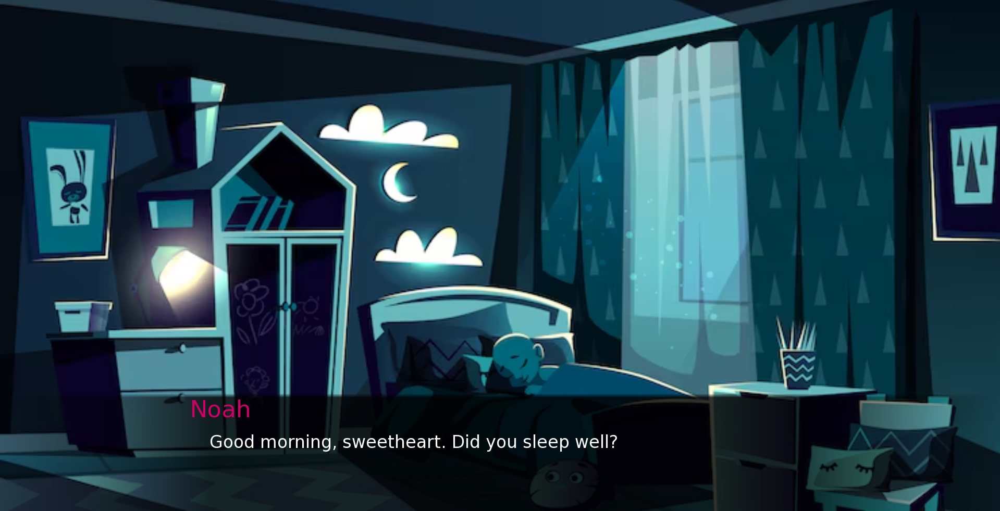
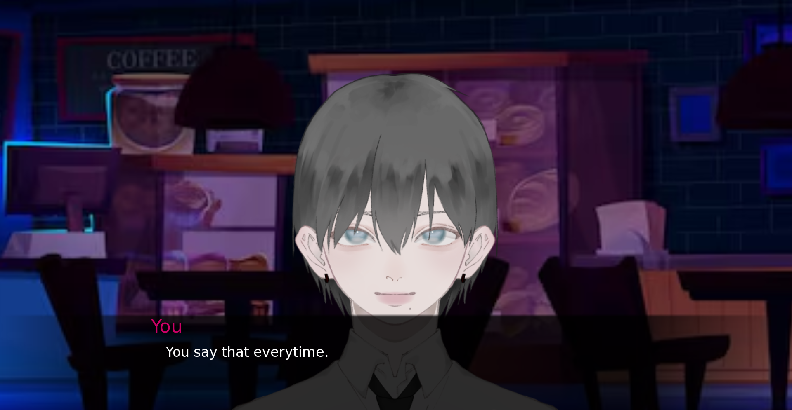

## Honey, you're buffering

Demo: https://khanaaaaaa.itch.io/honey-youre

# What It Is

A psychological horror (romance?) visual novel game where your boyfriend keeps forgetting the same things, and he says the same thing everyday. 

# Why I Made It

Saw a short tiktok video on a meme about the popular girl having an NPC boyfriend and saw horror potential so decided to immediately make it. Lowk all my ideas are ignited on Tiktok T-T

# How I Made It

Tech stack:

- Renpy

Renpy is quite simple, and my favorite. I want to work on it more later on, but I want to complete all my games before that cause there's a lot

# What I Struggled With & What I Learnt
Kinda the first time where I didn't branch the condition with just menu and added conditions from previous dialogues with numbers (I hate numbers). Yeah, the main thing I struggles with was that I used += instead of =+ which made me stick for such a long time. 

# Screenshots

